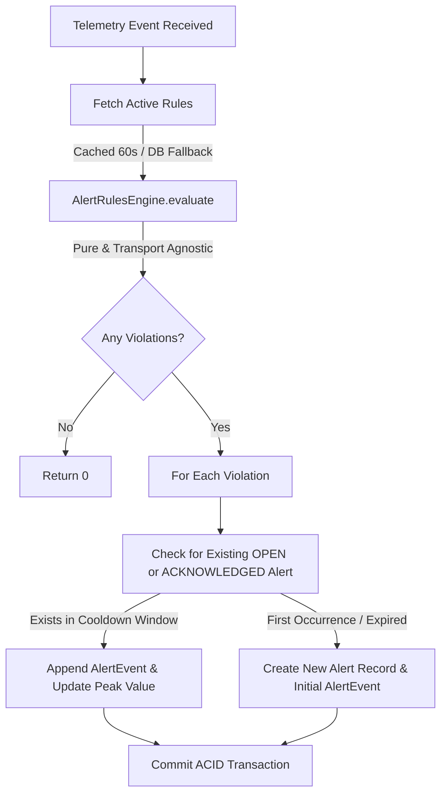

# Architecture Decision Record: Alert Rules Engine & Deduplication (Phase 18)

## 1. Overview
The Alert Rules Engine in `alert-service` evaluates real-time vehicle telemetry against safety and mechanical thresholds. To prevent alert storms (where hundreds of events per minute create hundreds of duplicate tickets), the engine incorporates an in-memory evaluation pipeline coupled with database-backed cooldown deduplication.

---

## 2. Default Rules Matrix

| Rule Name | Condition Type | Threshold | Operator | Severity | Cooldown | Purpose |
|---|---|---|---|---|---|---|
| Speed Limit Exceeded | `SPEED_LIMIT` | `120.0` | `>` | `HIGH` | 300s | Detect dangerous driving and speed compliance |
| Engine Overheating | `ENGINE_TEMP` | `110.0` | `>` | `CRITICAL` | 600s | Prevent catastrophic engine failure and head gasket blown |
| Battery Voltage Low | `BATTERY_VOLTAGE` | `11.5` | `<` | `MEDIUM` | 1800s | Warn before alternator or battery failure causes breakdown |
| Harsh Braking Detected | `HARSH_BRAKING` | `-0.45` | `<=` | `MEDIUM` | 60s | Detect aggressive stop or collision avoidance behavior |
| Extreme Acceleration | `EXTREME_ACCELERATION` | `0.40` | `>=` | `LOW` | 60s | Identify reckless acceleration or aggressive driving |
| Low Fuel Warning | `LOW_FUEL` | `10.0` | `<=` | `LOW` | 3600s | Fleet fuel alert when tank drops below critical minimum |

---

## 3. Architecture & Execution Flow

### Key Design Pillars:
1. **Pure & Transport Agnostic:**
   `AlertRulesEngine.evaluate(event, rules)` has zero I/O dependencies. It can be executed inside Kafka streams, HTTP controllers, or offline backtesting scripts.
2. **Alert Storm Prevention (Deduplication):**
   If an open or acknowledged alert exists for the vehicle and rule condition, the engine updates `triggerValue` (recording peak violation value) and inserts a detailed `AlertEvent` (`ALERT_COOLDOWN_TRIGGER`) without creating a new top-level `Alert` entity.
3. **Audit Trail Completeness:**
   Every single violation ping generates an immutable `alert_events` entry with latitude, longitude, exact value, and timestamp. Fleet managers have full historical replay of the incident without cluttering their active incident board.
