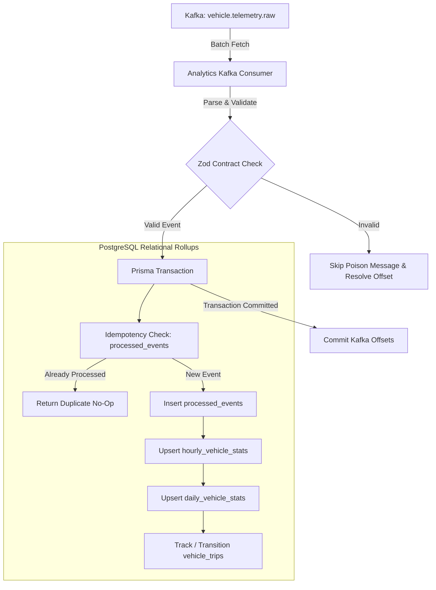

# Phase 15 Architecture: Analytics Schema & Aggregation Consumer

## 1. Overview
Phase 15 turns real-time raw vehicle telemetry into analytical intelligence in PostgreSQL. The `analytics-service` subscribes to Kafka topic `vehicle.telemetry.raw` under consumer group `analytics-consumer-group`, executing atomic batch transactions that update hourly and daily statistical rollups, record trips, and guarantee idempotency.

---

## 2. Architecture & Data Flow

### Core Design Rules
1. **Replay-Safe Deduplication**: Each telemetry event has a deterministic UUID (`eventId`). The transaction first verifies `processed_events`. If present, the event is flagged as duplicate and analytical counters are not incremented.
2. **Transactional Integrity**: All updates (`processed_events`, `hourly_vehicle_stats`, `daily_vehicle_stats`, `vehicle_trips`) happen inside an atomic `prisma.$transaction`.
3. **Decoupled Offsets**: `autoCommit: false`. Offsets are committed only after transaction persistence completes.

---

## 3. Data Models
- **`ProcessedEvent`**: Tracks UUID, event type, vehicle ID, and processing timestamp.
- **`HourlyVehicleStat`**: Hourly bucket rollups (average speed, max speed, idle time, event count). Compound unique key: `(vehicleId, bucketStart)`.
- **`DailyVehicleStat`**: Daily rollups per vehicle. Compound unique key: `(vehicleId, date)`.
- **`VehicleTrip`**: State machine tracking trip status (`ACTIVE` vs `COMPLETED`), start/end locations, duration, and maximum speeds.

---

## 4. Analytical Query APIs
All endpoints are reverse-proxied through Nginx on Port 80:
- `GET /api/analytics/v1/summary`: Overall fleet metrics (total processed events, tracked vehicles, active trips).
- `GET /api/analytics/v1/vehicles/:vehicleId/hourly`: Hourly rollups for a vehicle (supports `?from=...&to=...&limit=...`).
- `GET /api/analytics/v1/vehicles/:vehicleId/daily`: Daily aggregate history for a vehicle.
- `GET /api/analytics/v1/vehicles/:vehicleId/trips`: List vehicle trips with status filtering (`?status=ACTIVE`).

---

## 5. Verification
- **Test Suite**: `npm run test --workspace=@vehicle-pulse/analytics-service` executed with:
  - 1/1 suite passing verifying idempotency, duplicate protection, hourly/daily rollups, trip start/update, and HTTP APIs.
- **Runtime Verification**:
  - `curl.exe http://localhost/api/analytics/v1/summary` returns live totals across tracked fleet.
  - `curl.exe http://localhost/api/analytics/v1/vehicles/:vehicleId/hourly` returns bucketed metrics.
