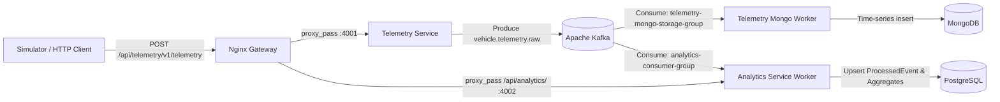

# Phase 14 Architecture: Analytics Service Foundation

## 1. Overview
The **Analytics Service** (`backend/services/analytics-service`) is an independent microservice responsible for consuming real-time telemetry events from Apache Kafka, performing historical rollups and aggregations, and maintaining relational analytical query capabilities in PostgreSQL with Prisma ORM.

---

## 2. Architecture & Design Principles

### Decoupled Consumer Groups
- **`telemetry-mongo-storage-group`**: In `telemetry-service`, persists raw time-series measurements in MongoDB.
- **`analytics-consumer-group`**: In `analytics-service`, independently processes events from the same `vehicle.telemetry.raw` topic. Both consumers advance their offsets independently without interference.

### Zero-Data-Loss & At-Least-Once Delivery
- `autoCommit: false`
- `eachBatchAutoResolve: false`
- Offsets are committed via `commitOffsetsIfNecessary()` **only after** Prisma executes the durable upsert to PostgreSQL.
- **Idempotency**: Deduplication uses `processed_events` table with unique constraint on `eventId` (UUID). Re-delivered Kafka messages trigger `update: {}` no-ops.

---

## 3. Database Schema (Prisma)
- **Engine**: PostgreSQL 16
- **Models**:
  - `ProcessedEvent`: Tracks idempotency, event types, vehicle IDs, and processing timestamps.
  - `HourlyVehicleStat`: Pre-computed analytical rollups (average speed, total distance, max rpm, idle durations).

---

## 4. Endpoints & Gateway Integration
All endpoints are reverse-proxied through Nginx on Port 80:
- `GET /api/analytics/health/live`: Process liveness check.
- `GET /api/analytics/health/ready`: Readiness probe verifying live connection to PostgreSQL (`SELECT 1`) and Kafka consumer heartbeat.
- `GET /api/analytics/v1/health`: Operational metrics probe returning total processed events count in PostgreSQL.

---

## 5. Verification
- **Unit & Integration Suite**: `npm run test --workspace=@vehicle-pulse/analytics-service` passed with 2/2 tests:
  - Express application readiness & DB probe passed.
  - Kafka-to-PostgreSQL event processing with idempotent upsert passed.
- **Runtime Docker Verification**: Container `vehiclepulse-analytics-service` built and running healthy on internal port 4002, accessible via Nginx reverse proxy on port 80.
