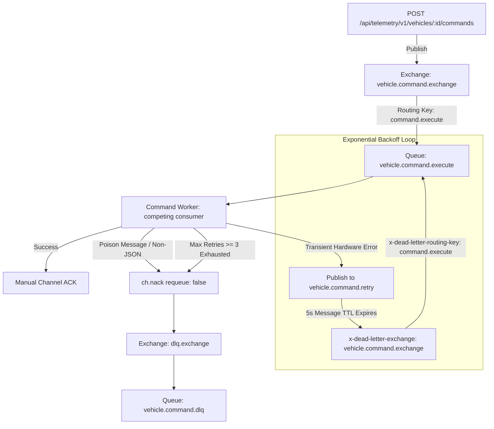

# Architecture Decision Record: RabbitMQ Jobs, Command Queues, Retries & Dead Letter Queue (Phase 20)

## 1. Overview
RabbitMQ in VehiclePulse handles **asynchronous point-to-point and targeted broadcast tasks** (such as remote vehicle commands, firmware updates, and notification jobs), whereas Apache Kafka remains strictly dedicated to high-throughput telemetry event streaming.

---

## 2. RabbitMQ Topology & Dead Letter Architecture



### Key Pillars:
1. **Durable Exchanges & Queues:**
   - Exchanges: `vehicle.command.exchange` (direct), `notification.exchange` (topic), `alert.exchange`, and `dlq.exchange`.
   - Queues: `vehicle.command.execute`, `vehicle.command.retry`, `vehicle.command.dlq`.
2. **Exponential Backoff via TTL Queues:**
   - Dead-letter TTL routing queues are used without third-party plugins. A failing job is published with header `x-retry-count: n`. It sits in `vehicle.command.retry` for 5,000ms TTL, after which RabbitMQ dead-letters it back to `vehicle.command.execute`.
3. **Poison-Pill & Max Retry Isolation:**
   - Corrupt bytes or schema-invalid messages are immediately rejected without requeue (`requeue: false`), routing them directly to `dlq.exchange` ➔ `vehicle.command.dlq`.
   - Messages exceeding `MAX_RETRIES` (3 attempts) are moved permanently to the DLQ for manual inspection.
4. **Command Worker Microservice:**
   - Standalone worker created at [`backend/workers/command-worker`](file:///E:/Projects%202026/VehiclePulse/backend/workers/command-worker) with controlled prefetch (`PREFETCH=10`) and competing consumer horizontal scalability.
   - Containerized as `vehiclepulse-command-worker`.
5. **HTTP Dispatch API:**
   - `POST /api/telemetry/v1/vehicles/:id/commands` accepts commands (`LOCK_DOORS`, `UNLOCK_DOORS`, `START_ENGINE`, `STOP_ENGINE`, `FLASH_LIGHTS`, `HONK_HORN`, `SET_SPEED_LIMIT`), publishing them to RabbitMQ with unique `correlationId`s.

---

## 3. Test & Verification Evidence
- Automated test file: [`commandWorker.test.ts`](file:///E:/Projects%202026/VehiclePulse/backend/workers/command-worker/src/tests/commandWorker.test.ts)
  - `should publish a vehicle command and consume it with manual ACK` (PASS)
  - `should forward poison non-JSON payloads directly to DLQ without crashing` (PASS)
  - `should retry transient failures with incrementing x-retry-count header` (PASS)
- End-to-end runtime verification:
  - Dispatched `LOCK_DOORS` to `veh_live_test` via Nginx gateway ➔ `202 Accepted`.
  - Verified worker output in `vehiclepulse-command-worker`:
    ```text
    INFO (command-worker): Executing vehicle command: LOCK_DOORS
    INFO (command-worker): Vehicle veh_live_test doors locked successfully
    ```
