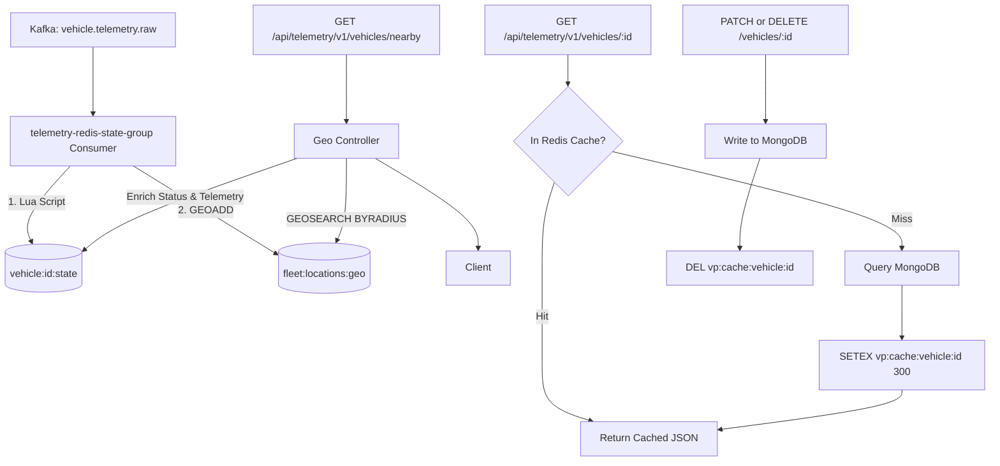

# Architecture Decision Record: Redis Caching & GEO Proximity Search (Phase 22)

## 1. Overview
VehiclePulse implements sub-millisecond proximity queries and read optimization using **Redis Geospatial (GEO)** and the **Cache-Aside Pattern**:
1. **Geospatial Proximity:** Uses Redis `GEOADD` and `GEOSEARCH` to locate nearby vehicles within any given radius (in km) with sub-millisecond latency.
2. **Cache-Aside Pattern:** Reduces MongoDB read pressure on vehicle metadata queries by caching responses in Redis with explicit invalidation upon updates/deletions.

---

## 2. Architecture & Data Flow

---

## 3. Key Components
1. **`VehicleGeoService` (`@vehicle-pulse/shared`):**
   - Stores coordinates via Redis `GEOADD`.
   - Executes radius searches via `GEOSEARCH ... FROMLONLAT lon lat BYRADIUS radius km WITHDIST WITHCOORD COUNT limit ASC`.
   - Cleans up deleted/decommissioned vehicles with `ZREM`.
2. **`CacheService` (`@vehicle-pulse/shared`):**
   - Generic `getOrSet<T>()` cache-aside helper.
   - Configurable TTL (default 300s / 5 minutes).
   - Invalidation hooks `invalidate(key)` and `invalidatePattern(pattern)`.
   - Hit/miss metrics tracking (`hits`, `misses`, `ratio`).
3. **Kafka Consumer Integration:**
   - In `redisStateConsumer.ts`, every consumed telemetry point with GPS coordinates updates `fleet:locations:geo`.
4. **Endpoints:**
   - `GET /api/telemetry/v1/vehicles/nearby?lat=...&lng=...&radiusKm=...&limit=...`
   - `GET /api/telemetry/v1/vehicles/cache/metrics`
   - Documented in OpenAPI 3.1 specification at `/api/telemetry/docs`.

---

## 4. Test & Verification Evidence
- Automated test file: [`backend/services/telemetry-service/src/tests/redisGeoCache.test.ts`](file:///E:/Projects%202026/VehiclePulse/backend/services/telemetry-service/src/tests/redisGeoCache.test.ts)
  - `should index vehicle coordinates using GEOADD and find them within radius using GEOSEARCH` (PASS)
  - `should remove vehicle from geospatial index when decommissioned or removed` (PASS)
  - `should execute Cache-Aside pattern, verify Cache Hit vs Miss latency, and track metrics` (PASS)
  - `should invalidate cached entry upon write or deletion` (PASS)
- Total test suite: **26/26 tests passing** in telemetry-service.
- Live Docker verification:
  - `GET /api/telemetry/v1/vehicles/cache/metrics` ➔ `200 OK`
  - `GET /api/telemetry/v1/vehicles/nearby?lat=23.8103&lng=90.4125&radiusKm=50` ➔ `200 OK`
