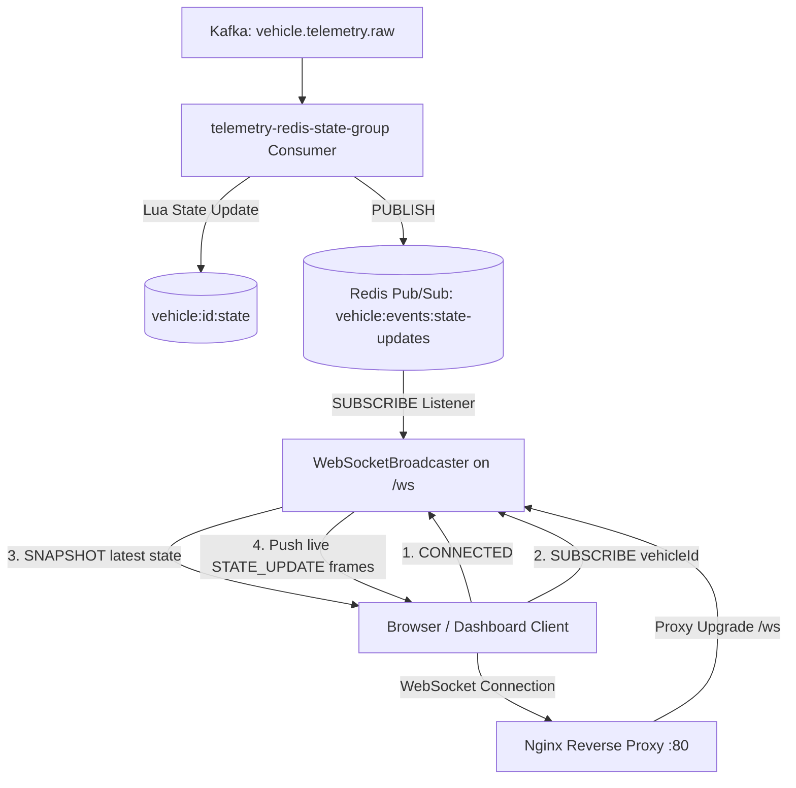

# Architecture Decision Record: Redis Pub/Sub & WebSocket Live State Streaming (Phase 24)

## 1. Overview
VehiclePulse provides real-time vehicle telemetry and state streaming to web dashboard clients using **Redis Pub/Sub** and a native Node.js **WebSocket Server** mounted behind **Nginx (port 80)**:
1. **Decoupled Event Distribution:** The Kafka state consumer publishes accepted telemetry state updates to Redis channel `vehicle:events:state-updates`.
2. **WebSocket Broadcaster:** Express HTTP server attaches a WebSocket server (`ws`) on `/ws`.
3. **Subscription Filtering:** Clients can subscribe to specific vehicle IDs (`SUBSCRIBE`) or receive global fleet state.
4. **Snapshot Recovery:** Supports reconnect recovery (`SNAPSHOT`) so browsers immediately obtain current vehicle telemetry without waiting for the next ping.
5. **Backpressure & Heartbeat:** Disconnects unresponsive clients (ping/pong failure) and drops non-critical frames if a client's send buffer exceeds 64 KB.

---

## 2. Architecture & Data Flow

---

## 3. Key Components

### A. `WebSocketBroadcaster`
Located in [`backend/services/telemetry-service/src/app/websocket/wsBroadcaster.ts`](file:///E:/Projects%202026/VehiclePulse/backend/services/telemetry-service/src/app/websocket/wsBroadcaster.ts):
- Listens on `/ws` with a maximum payload cap of 64 KB.
- Maintains heartbeat pings every 30 seconds (`ws.ping()`).
- Tracks per-client subscriptions in memory.
- Monitors `ws.bufferedAmount`: if a client's TCP buffer exceeds 64 KB, drops frames to prevent memory leaks on slow networks.
- Safe lifecycle shutdown cleanly terminates sockets and disconnects the duplicate Redis subscriber client.

### B. Redis Pub/Sub Integration
- Channel: `vehicle:events:state-updates`.
- Whenever `TelemetryRedisStateConsumer` successfully processes an event (passing the atomic Lua out-of-order check), it publishes the updated state JSON to the channel.

### C. Nginx Reverse Proxy Configuration
- `/ws` location in `nginx.conf`:
  - `proxy_http_version 1.1;`
  - `proxy_set_header Upgrade $http_upgrade;`
  - `proxy_set_header Connection "upgrade";`
  - `proxy_read_timeout 86400s;`

---

## 4. Test & Verification Evidence
- Automated test file: [`backend/services/telemetry-service/src/tests/redisPubSubWs.test.ts`](file:///E:/Projects%202026/VehiclePulse/backend/services/telemetry-service/src/tests/redisPubSubWs.test.ts)
  - `should connect to WebSocket server, receive connection confirmation, and reply to ping` (PASS)
  - `should broadcast real-time state updates to connected clients via Redis Pub/Sub` (PASS)
  - `should return an instant snapshot of vehicle state upon SUBSCRIBE command or reconnect` (PASS)
- Live Docker & Nginx verification:
  - Connected directly to `ws://localhost:4001/ws` ➔ `200 Handshake / CONNECTED`.
  - Connected through Nginx reverse proxy `ws://nginx/ws` (Port 80) ➔ `OPENED_VIA_NGINX` and received initial `CONNECTED` greeting.
