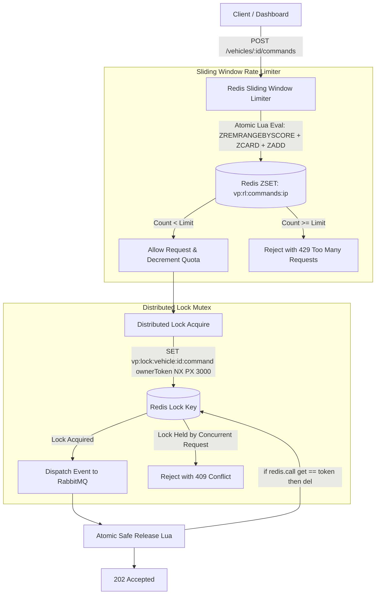

# Architecture Decision Record: Redis Rate Limiting, Lua, and Distributed Locks (Phase 23)

## 1. Overview
VehiclePulse implements distributed concurrency controls and resource protection using **Redis sorted sets (ZSET)**, **atomic Lua scripts**, and **Redlock mutex primitives**:
1. **Sliding Window Rate Limiter:** Protects public and sensitive HTTP endpoints (e.g. `POST /api/telemetry/v1/vehicles/:id/commands`) from abusive traffic and request flooding.
2. **Distributed Mutex Lock:** Prevents racing concurrent operations on the same vehicle (e.g. concurrent `LOCK_DOORS` or `START_ENGINE` requests).

---

## 2. Architecture & Data Flow



---

## 3. Key Components & Implementations

### A. `SlidingWindowRateLimiter` (`@vehicle-pulse/shared`)
- Uses Redis sorted set where:
  - **Score:** Millisecond timestamp (`now`).
  - **Member:** Unique request identifier (`${now}-${random}`).
- Atomic Lua script execution:
  1. Purges requests older than window start: `ZREMRANGEBYSCORE key -inf windowStart`.
  2. Queries current count: `ZCARD key`.
  3. If under limit: adds request with `ZADD` and refreshes `EXPIRE`. Returns `{ allowed: 1, total, remaining }`.
  4. If over limit: returns `{ allowed: 0, total, 0 }`.
- Sets standard RFC 6585 headers: `RateLimit-Limit`, `RateLimit-Remaining`, `RateLimit-Reset`, `Retry-After`.

### B. `DistributedLock` (`@vehicle-pulse/shared`)
- Acquisition: `SET resource token NX PX ttlMs`.
  - `NX`: Set only if key does not exist.
  - `PX`: Set millisecond TTL (ensuring crashes do not leak permanent locks).
- Atomic safe release via Lua script:
  ```lua
  if redis.call("get", KEYS[1]) == ARGV[1] then
    return redis.call("del", KEYS[1])
  else
    return 0
  end
  ```
  - Prevents a slow process from deleting a lock that has expired and was re-acquired by another process.

---

## 4. Test & Verification Evidence
- Automated test file: [`backend/services/telemetry-service/src/tests/redisLockRateLimit.test.ts`](file:///E:/Projects%202026/VehiclePulse/backend/services/telemetry-service/src/tests/redisLockRateLimit.test.ts)
  - `should allow requests within limit and correctly decrement remaining quota` (PASS)
  - `should reject requests exceeding maximum allowed requests in the sliding window` (PASS)
  - `should slide window and replenish quota after window duration elapses` (PASS)
  - `should acquire lock on resource and block concurrent attempts on the same resource` (PASS)
  - `should safely release lock only if caller possesses the correct owner token` (PASS)
  - `should automatically release lock via TTL if process crashes or fails to release` (PASS)
- Total test suite: **32/32 tests passing** across 8 test suites.
- Live Docker verification:
  - Dispatched 7 rapid concurrent commands to `POST /api/telemetry/v1/vehicles/veh_lock_demo/commands`.
  - Observed exact expected tiering:
    - Initial requests accepted: `202 Accepted` (`RateLimit-Remaining: 3`, `2`).
    - Concurrent command collision detected: `409 Conflict` (Blocked by Distributed Lock).
    - Rate limit threshold reached: `429 Too Many Requests` (`RateLimit-Remaining: 0`).
