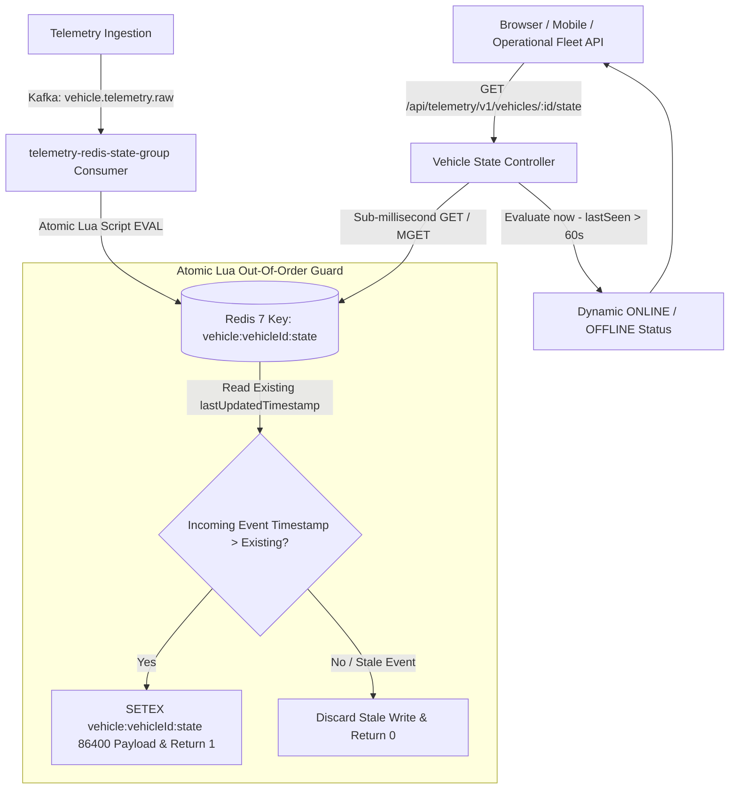

# Architecture Decision Record: Redis Real-Time State & Out-Of-Order Protection (Phase 21)

## 1. Overview
VehiclePulse maintains sub-millisecond current vehicle state (dynamic `ONLINE`/`OFFLINE` status, latest GPS position, speed, battery, fuel level, and telemetry timestamp) in **Redis**. This eliminates heavy database disk I/O on operational dashboards and powers live fleet monitoring.

---

## 2. Architecture & Data Flow

### Key Technical Pillars:
1. **Dedicated Kafka State Consumer (`telemetry-redis-state-group`):**
   - Consumes directly from `vehicle.telemetry.raw`.
   - Offsets are committed **only after** Redis writes finish cleanly.
2. **Atomic Out-of-Order & Stale-Update Protection via Lua:**
   - In real-world cellular IoT, older delayed pings can arrive out of order over the network after newer pings have already been processed.
   - We execute an atomic Redis Lua script (`ATOMIC_UPDATE_STATE_LUA`) that compares the incoming event's epoch millisecond timestamp against `lastUpdatedTimestamp`. Older events are safely discarded (`return 0`).
3. **Dynamic Staleness & Online/Offline Evaluation:**
   - Rather than scheduling timer jobs across thousands of vehicles, staleness is evaluated dynamically:
     - `offlineThresholdSeconds` = 60s.
     - If `(now - lastSeen) > 60s`, vehicle status is automatically returned as `OFFLINE` (`isOnline: false`). Otherwise `ONLINE` (`isOnline: true`).
4. **Key TTL:**
   - Keys (`vehicle:{vehicleId}:state`) have a sliding TTL of 24 hours (`86,400s`), preventing unmanaged memory expansion for decommissioned vehicles.
5. **Real-Time API & OpenAPI 3.1 Spec:**
   - Endpoint: `GET /api/telemetry/v1/vehicles/:id/state` mounted through Nginx gateway.
   - Batch retrieval: `getMultipleVehicleStates([ids])` via Redis `MGET`.
   - Documented in OpenAPI specification at `/api/telemetry/docs`.

---

## 3. Test & Verification Evidence
- Automated test file: [`backend/services/telemetry-service/src/tests/redisState.test.ts`](file:///E:/Projects%202026/VehiclePulse/backend/services/telemetry-service/src/tests/redisState.test.ts)
  - `should atomically save real-time vehicle state to Redis and retrieve it with sub-millisecond latency` (PASS)
  - `should prevent out-of-order/stale events from overwriting newer state (Atomic Lua Protection)` (PASS)
  - `should dynamically calculate OFFLINE status when telemetry age exceeds offline threshold` (PASS)
  - `should batch retrieve multiple vehicle states in a single MGET call` (PASS)
- Total test suite: 22/22 tests passing in telemetry-service.
- Live end-to-end gateway test:
  - Ingested event via `POST /api/telemetry/v1/telemetry` for `veh_redis_live_demo`.
  - Kafka consumer received event and updated Redis.
  - Queried `GET /api/telemetry/v1/vehicles/veh_redis_live_demo/state` ➔ `200 OK` (Speed: `88.5`, Status: `ONLINE`, latency < 2ms).
